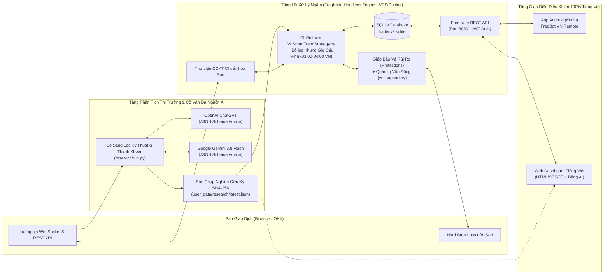

# TÀI LIỆU GIỚI THIỆU DỰ ÁN (PROJECT INTRODUCTION)
**Tên dự án:** Hệ thống Giao dịch Tiền điện tử Tự động, Phân tích AI Đa nguồn & Ứng dụng Điều khiển Từ xa Tiếng Việt (**FreqBot VN Remote**) 
**Phiên bản:** 2.0.0 
**Ngày cập nhật:** 27/10/2026 

---

## 1. Đặt Vấn Đề & Lý Do Hình Thành Dự Án

Giao dịch tiền điện tử (Cryptocurrency Trading) trên các sàn thương mại lớn như **Binance** và **OKX** hoạt động liên tục 24/7/365 không có giờ nghỉ. Đối với nhà đầu tư và lập trình viên muốn tối ưu hóa lợi nhuận đồng thời hạn chế tối đa rủi ro mất vốn, việc giao dịch thủ công hoặc dùng bot thông thường gặp phải 5 bài toán lớn:
1. **Giới hạn sinh học và tâm lý giao dịch:** Con người không thể canh biểu đồ 24/24, dễ rơi vào trạng thái FOMO (mua đuổi khi giá tăng nóng) hoặc hoảng loạn (không dám cắt lỗ khi thị trường sập).
2. **Rủi ro nhiễu thanh khoản khi giao dịch dàn trải 24/24:** Theo kinh nghiệm thực chiến của giới giao dịch chuyên nghiệp tại Việt Nam, không phải khung giờ nào trong ngày cũng có cấu trúc thanh khoản tốt cho các cặp `*/USDT`. Nhiều thời điểm giao dịch trong ngày thường xuyên xảy ra hiện tượng quét râu nến hai đầu (Stop-Hunt / Fakeout) do tin tức vĩ mô đột xuất. Trong khi đó, các khung giờ chuyển giao phiên như **03:00 – 04:00 sáng theo giờ Việt Nam (`Asia/Ho_Chi_Minh`)** là một giả thuyết cần kiểm chứng trên từng cặp và sàn, chưa có kết luận về xu hướng hoặc spread.
3. **Thiếu sự kết hợp giữa Định lượng Kỹ thuật và Trí tuệ Nhân tạo Đa nguồn (Multi-AI Consensus):** Một chiến lược chỉ nhìn vào công thức chỉ báo đơn thuần có thể vào lệnh trên những đồng coin đang có cấu trúc thị trường xấu hoặc biến động bất thường. Việc kết hợp bộ sàng lọc kỹ thuật định lượng với nhận định độc lập từ nhiều mô hình AI (**OpenAI ChatGPT** và **Google Gemini**) giúp tạo ra hội đồng thẩm định đa chiều trước khi xuống tiền.
4. **Độ phức tạp kỹ thuật nếu tự viết Bot từ con số 0:** Một hệ thống giao dịch thực chiến đòi hỏi xử lý hàng loạt bài toán hạ tầng phức tạp: tự động kết nối lại WebSocket khi đứt mạng, chuẩn hóa quy tắc làm tròn số lẻ của từng cặp coin (`tickSize`, `stepSize`, `minNotional`), xử lý lệnh khớp một phần (`Partially Filled`), chống đặt trùng lệnh (`Idempotency`), và kiểm soát giới hạn gọi API (`Rate Limit`).
5. **Rào cản ngôn ngữ và khả năng giám sát di động:** Các phần mềm giao dịch mã nguồn mở hàng đầu như **Freqtrade** thiếu giao diện điều khiển 100% Tiếng Việt hiển thị rõ trạng thái khung giờ, đề xuất AI và các nút khẩn cấp như **"Tạm dừng Mua mới"** hay **"Bán khẩn cấp toàn bộ (Panic Sell)"**.

---

## 2. Triết Lý Giải Pháp: "Đứng Trên Vai Người Khổng Lồ + Hội Đồng Thẩm Định AI Đa Tầng"

Thay vì viết lại hàng chục nghìn dòng mã nguồn hạ tầng kết nối sàn tiềm ẩn rủi ro mất tiền thật, dự án **FreqBot VN Remote v2.0** áp dụng kiến trúc ghép nối 3 tầng:

### 2.1. Tầng Lõi Xử Lý Ngầm Đa Sàn (Freqtrade Headless Backend trên Binance & OKX)
- Sử dụng **Freqtrade** chạy 24/7 trên máy chủ Linux VPS thông qua Docker, hỗ trợ chuyển đổi linh hoạt giữa **Binance** ([`config.json`](file:///d:/Project/trade_bot/freqtrade-bot/user_data/config.json)) và **OKX** ([`config-okx.json`](file:///d:/Project/trade_bot/freqtrade-bot/user_data/config-okx.json)).
- Chiến lược định lượng [`VnSmartTrendStrategy.py`](file:///d:/Project/trade_bot/freqtrade-bot/user_data/strategies/VnSmartTrendStrategy.py) kết hợp module chính sách [`vn_support.py`](file:///d:/Project/trade_bot/freqtrade-bot/user_data/strategies/vn_support.py) kiểm soát chặt chẽ khung giờ giao dịch, phân bổ vốn động theo rủi ro và đối chiếu báo cáo AI trước khi vào lệnh.

### 2.2. Tầng Phân Tích Thị Trường & Đề Xuất Coin Đa Nguồn AI (`research/`)
- Chạy độc lập dưới dạng dịch vụ chỉ đọc (`Read-Only Worker` — không giữ khóa đặt lệnh của sàn để đảm bảo an toàn bảo mật tuyệt đối).
- Tự động quét dữ liệu nến, sổ lệnh (`Orderbook`) và khối lượng giao dịch 24h của các cặp `*/USDT` trên Binance/OKX.
- Tính toán điểm sức mạnh kỹ thuật (`0–100`), kiểm tra xu hướng `EMA 20/50/200`, động lượng `RSI(14)`, độ giãn `Spread`, độ biến động `Volatility 5m` và biến động giá 1 giờ.
- Tham vấn độc lập **OpenAI ChatGPT** và **Google Gemini** (model hỗ trợ structured output do tài khoản cho phép) để nhận khuyến nghị `consider` (xem xét mua), `avoid` (tránh giao dịch) hoặc `wait` (chờ đợi) kèm lý do phân tích bằng Tiếng Việt.

### 2.3. Tầng Giao Diện Điều Khiển Từ Xa Tiếng Việt (Android App & Web Dashboard)
- **Ứng dụng Android (`FreqBot VN Remote`):** Hiển thị trạng thái lợi nhuận, số dư, khung giờ giao dịch vàng, nhận định đề xuất coin từ AI, danh sách lệnh mở và cảnh báo rủi ro chạy ngầm (`WorkManager`).
- **Giao diện Web Dashboard Tiếng Việt:** Theo dõi trực quan bảng lệnh mở, trạng thái khung giờ giao dịch và bảng phân tích chi tiết từng đồng coin kèm nhận định từ ChatGPT & Gemini.

---

## 3. Phạm Vi & Các Tính Năng Nổi Bật Của Hệ Thống

1. **Bộ Lọc Khung Giờ Giao Dịch Vàng (`03:00 – 04:00` sáng giờ Việt Nam):**
   - Cấu hình linh hoạt một hoặc nhiều khung giờ trong ngày theo chuẩn múi giờ `Asia/Ho_Chi_Minh (UTC+7)`.
   - **Chỉ lọc lệnh Mua mới (`enter_long`)**: Ngoài khung giờ quy định, bot tuyệt đối không mở thêm vị thế mới để tránh nhiễu thị trường, nhưng **vẫn canh Chốt lời (`ROI`, `Trailing Stop`), Cắt lỗ (`Stop-Loss`) và Bán khẩn cấp 24/7**.
2. **Đề Xuất Coin & Phân Tích Thị Trường Từ Đa Nguồn AI (`ChatGPT` + `Gemini`):**
   - Bấm điểm kỹ thuật `0–100` và phân loại trạng thái thị trường (`TĂNG_ỔN_ĐỊNH`, `TÍCH_LŨY`, `BIẾN_ĐỘNG_CAO`, `THANH_KHOẢN_THẤP`).
   - Cơ chế đồng thuận đa AI (`min_ai_votes`) và quyền phủ quyết (`Veto`: chỉ cần 1 mô hình AI cảnh báo `avoid` là tự động chặn mua cặp coin đó trong chế độ `required`).
3. **Bảo Vệ Vốn Đa Tầng & Phân Bổ Vốn Động (`Multi-Layer Risk Management`):**
   - Tự động tính toán khối lượng vào lệnh (`stake_size`) sao cho mức lỗ tối đa khi chạm Stop-Loss cộng phí/trượt giá không vượt quá `0.5% – 2%` tổng vốn tài khoản, đồng thời giới hạn tổng vốn phơi nhiễm tối đa (`60%`).
   - Đặt lệnh cắt lỗ cứng trực tiếp trên máy chủ sàn (`stoploss_on_exchange: true`) kết hợp bộ 4 lớp giáp `Protections` (`MaxDrawdown`, `StoplossGuard`, `CooldownPeriod`, `LowProfitPairs`).
4. **Bộ Đôi Nút Điều Khiển Khẩn Cấp (Emergency Controls) Trên Android & Web:**
   - **Nút "Tạm dừng Mua mới" (`/api/v1/stopbuy`)** và **Nút đỏ "Bán khẩn cấp toàn bộ - Panic Sell" (`/api/v1/forceexit`)** thu hồi toàn bộ vốn về `USDT` ngay lập tức.
# Ghi chú về phạm vi triển khai ngày 27/10/2026

Áp dụng [đặc tả bổ sung 07](07-LICH-GIAO-DICH-AI-VA-PHAN-TICH.md) cho hành vi thực tế. Các mô tả “giờ vàng” bên dưới là giả thuyết chưa có bằng chứng lợi nhuận. Worker tính EMA/RSI, biến động, volume, spread và nhãn regime theo luật. Android hiển thị AI qua endpoint riêng của mock; web xem snapshot qua chọn tệp hoặc endpoint riêng của mock. Model/API key phải cấu hình riêng. SHA256 là mã nhận diện ngữ cảnh, không phải chữ ký xác thực. Sizing không bảo đảm mức lỗ thực tế.
