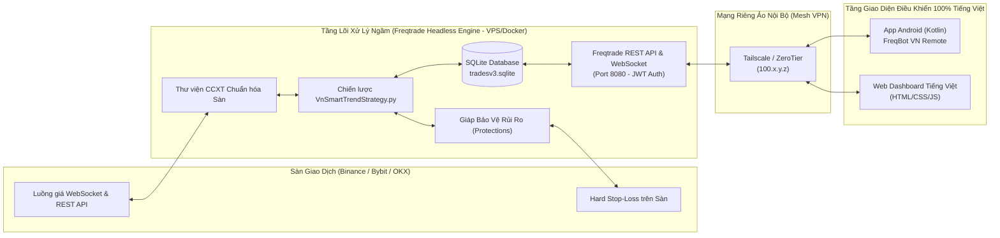

# TÀI LIỆU GIỚI THIỆU DỰ ÁN (PROJECT INTRODUCTION)
**Tên dự án:** Hệ thống Giao dịch Tiền điện tử Tự động & Ứng dụng Điều khiển Từ xa Tiếng Việt (**FreqBot VN Remote**)  
**Phiên bản:** 1.0.0  
**Ngày lập:** 27/10/2026  

---

## 1. Đặt Vấn Đề & Lý Do Hình Thành Dự Án

Giao dịch tiền điện tử (Cryptocurrency Trading) là một thị trường hoạt động liên tục 24/7/365 không có giờ nghỉ. Đối với nhà đầu tư cá nhân muốn tìm kiếm thêm thu nhập thụ động và chấp nhận rủi ro trong hạn mức cho phép, việc giao dịch thủ công gặp phải 3 rào cản lớn:
1. **Giới hạn sinh học và tâm lý giao dịch:** Con người không thể canh biểu đồ 24/24, dễ rơi vào trạng thái FOMO (mua đuổi khi giá tăng nóng) hoặc hoảng loạn (không dám cắt lỗ khi thị trường sập).
2. **Độ phức tạp kỹ thuật nếu tự viết Bot từ con số 0:** Một hệ thống giao dịch thực chiến không chỉ có công thức "mua thấp bán cao", mà đòi hỏi xử lý hàng loạt bài toán hạ tầng cực kỳ phức tạp: tự động kết nối lại WebSocket khi đứt mạng, chuẩn hóa quy tắc làm tròn số lẻ của từng cặp coin (`tickSize`, `stepSize`, `minNotional`), xử lý lệnh khớp một phần (`Partially Filled`), chống đặt trùng lệnh (`Idempotency`), và kiểm soát giới hạn gọi API (`Rate Limit`) để không bị sàn khóa IP.
3. **Rào cản ngôn ngữ và khả năng giám sát di động:** Các phần mềm giao dịch mã nguồn mở hàng đầu thế giới như **Freqtrade** cực kỳ mạnh mẽ và hoàn thiện về mặt kỹ thuật, nhưng toàn bộ giao diện, thông số kỹ thuật (`profit_ratio`, `stoploss_current_dist`, `MaxDrawdown`, `StoplossGuard`...) đều bằng tiếng Anh và thiếu một ứng dụng di động Android chuyên biệt, gọn nhẹ, 100% Tiếng Việt tích hợp các nút khẩn cấp như **"Tạm dừng Mua mới"** hay **"Bán khẩn cấp toàn bộ (Panic Sell)"**.

---

## 2. Triết Lý Giải Pháp: "Đứng Trên Vai Người Khổng Lồ"

Thay vì viết lại hàng chục nghìn dòng mã nguồn hạ tầng kết nối sàn tiềm ẩn rủi ro mất tiền thật, dự án **FreqBot VN Remote** áp dụng kiến trúc ghép nối 2 tầng:

### 2.1. Tầng Lõi Xử Lý Ngầm (Freqtrade Headless Backend)
- Sử dụng **Freqtrade** chạy 24/7 trên máy chủ Linux VPS (Ubuntu) thông qua Docker.
- Tận dụng sẵn kết nối hơn 100 sàn giao dịch qua **CCXT**, cơ sở dữ liệu **SQLite**, công cụ kiểm thử lịch sử (**Backtesting**) và bộ giáp quản trị rủi ro tự động (**Protections**).
- Viết chiến lược giao dịch định lượng riêng ([`VnSmartTrendStrategy.py`](file:///e:/Project/trade_bot/freqtrade-bot/user_data/strategies/VnSmartTrendStrategy.py)) tích hợp cảnh báo đẩy 100% Tiếng Việt.

### 2.2. Tầng Giao Diện Điều Khiển Từ Xa Tiếng Việt (Custom Vietnamese UI)
- **Ứng dụng Android (`FreqBot VN Remote`):** Viết bằng ngôn ngữ **Kotlin**, sử dụng `Retrofit2` + `Coroutines` để giao tiếp với REST API của Freqtrade và `WorkManager` để giám sát rủi ro chạy ngầm mỗi 15 phút ngay cả khi đóng ứng dụng.
- **Giao diện Web Dashboard Tiếng Việt:** Phục vụ theo dõi và điều khiển nhanh trên trình duyệt máy tính/điện thoại.
- **Máy chủ giả lập (`mock_api_server.py`):** Giúp kiểm thử toàn bộ chức năng của App Android và Web Dashboard ngay lập tức trong quá trình phát triển trước khi kết nối vào VPS thực tế.

---

## 3. Phạm Vi & Các Tính Năng Nổi Bật Của Hệ Thống

1. **Giao diện 100% Tiếng Việt trực quan, dễ hiểu:**
   - Dịch toàn bộ các chỉ số tài chính và trạng thái kỹ thuật của Freqtrade sang thuật ngữ Tiếng Việt rõ ràng: *Tổng lợi nhuận (USDT & %), Tỷ lệ thắng (Winrate), Sụt giảm tối đa (Max Drawdown), Vốn rảnh rỗi (Free USDT), Vốn đang nằm trong lệnh, Giá mua vào, Giá hiện tại, Mốc cắt lỗ cứng (Stop-Loss)*.
2. **Bảo vệ vốn đa tầng (Multi-Layer Risk Management):**
   - Giới hạn rủi ro mỗi lệnh từ 1% – 2% tổng vốn.
   - Đặt lệnh cắt lỗ cứng trực tiếp trên máy chủ của sàn (`stoploss_on_exchange: true`) để bảo vệ tài khoản ngay cả khi VPS mất điện hoặc đứt cáp.
   - Bộ giáp `Protections` tự động khóa bot khi chạm ngưỡng lỗ ngày (`MaxDrawdown`) hoặc dính chuỗi lệnh thua liên tiếp (`StoplossGuard`).
3. **Bộ đôi Nút Điều Khiển Khẩn Cấp (Emergency Controls):**
   - **Nút "Tạm dừng Mua mới" (`/api/v1/stopbuy`):** Ngừng mở vị thế mới khi nhận thấy thị trường biến động xấu, nhưng vẫn để bot tự động canh chốt lời/cắt lỗ các lệnh đang giữ.
   - **Nút đỏ "Bán khẩn cấp toàn bộ - Panic Sell" (`/api/v1/forceexit`):** Đóng một lệnh cụ thể hoặc bán toàn bộ danh mục đang mở theo giá thị trường (`Market`) để thu hồi vốn về USDT ngay lập tức, được bảo vệ bằng hộp thoại xác nhận chống bấm nhầm.
4. **Cảnh báo rủi ro chạy ngầm trên điện thoại (`WorkManager`):**
   - Định kỳ 15 phút kiểm tra trạng thái máy chủ bot. Nếu phát hiện có lệnh đang lỗ vượt ngưỡng cảnh báo (ví dụ `-3%`), hoặc giáp bảo vệ vừa kích hoạt, hoặc máy chủ VPS mất kết nối, điện thoại sẽ rung và đẩy thông báo Tiếng Việt lên màn hình khóa.
5. **Kết nối mạng an toàn qua Mesh VPN (Tailscale/ZeroTier):**
   - Không mở cổng 8080 công khai ra Internet. Máy chủ bot và điện thoại Android kết nối qua mạng nội bộ mã hóa đầu cuối (`100.x.y.z`).

---

## 4. Đối Tượng Sử Dụng & Giá Trị Mang Lại

- **Người vận hành / Nhà đầu tư cá nhân:** Nắm toàn quyền kiểm soát hệ thống giao dịch tự động bằng Tiếng Việt ngay trên điện thoại Android cá nhân mà không phụ thuộc vào các nền tảng thuê bao đắt đỏ bên thứ ba (như 3Commas, Cryptohopper) và không phải giao nộp khóa API sàn cho máy chủ lạ.
- **Lập trình viên / Nhà nghiên cứu định lượng:** Sở hữu kiến trúc mẫu chuẩn mực kết hợp giữa lõi Python định lượng (Freqtrade) và ứng dụng di động Kotlin hiện đại, dễ dàng mở rộng thêm chiến lược hoặc chỉ báo mới.
