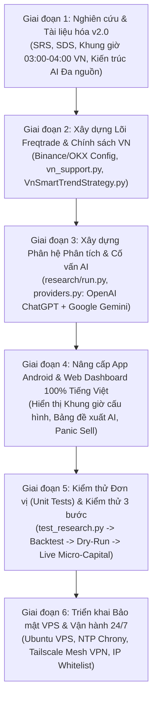

# KẾ HOẠCH TRIỂN KHAI DỰ ÁN (PROJECT MANAGEMENT PLAN)
**Tên dự án:** Hệ thống Giao dịch Tiền điện tử Tự động, Phân tích AI Đa nguồn & Ứng dụng Điều khiển Từ xa Tiếng Việt (**FreqBot VN Remote**) 
**Phiên bản:** 2.0.0 
**Ngày cập nhật:** 28/10/2026 

---

## 1. Mục Tiêu Của Kế Hoạch Dự Án

Tài liệu này xác định lộ trình triển khai, phân chia các giai đoạn công việc (Work Breakdown Structure - WBS), tiêu chí nghiệm thu kỹ thuật cho **Bộ lọc Khung Giờ Cấu Hình (03:00–04:00 VN)**, **Phân hệ Đề xuất Coin Đa nguồn AI (ChatGPT + Gemini)**, **Hỗ trợ Đa sàn (Binance & OKX)** và **Quy trình kiểm thử 3 bước bắt buộc** trước khi đưa hệ thống vào vận hành với vốn thực tế.

---

## 2. Sơ Đồ Lộ Trình Triển Khai (Project Roadmap)

---

## 3. Phân Chia Giai Đoạn & Hạng Mục Công Việc Chi Tiết (WBS)

| Mã GĐ | Tên Giai Đoạn | Hạng Mục Công Việc Cụ Thể | Sản Phẩm Bàn Giao (Deliverables) | Trạng Thái |
| :--- | :--- | :--- | :--- | :--- |
| **GĐ 1** | **Phân tích, Thiết kế & Bổ sung Tài liệu v2.0** | 1.1. Cập nhật Giới thiệu & Kế hoạch dự án với tính năng Khung giờ cấu hình & AI Advisor 1.2. Cập nhật SRS & SDS đặc tả chi tiết `vn_policy` (`schedule`, `risk`, `research`) 1.3. Viết tài liệu Cài đặt phần mềm & Hướng dẫn sử dụng toàn diện (`docs/08`) | - Bộ tài liệu `docs/01` đến `docs/08` (v2.0) - Bộ tài liệu `docs/freqtrade-vi/00` đến `06` | Hoàn thành |
| **GĐ 2** | **Xây dựng Lõi Chiến lược & Bộ lọc Khung giờ VN** | 2.1. Xây dựng [`vn_support.py`](file:///e:/Project/trade_bot/freqtrade-bot/user_data/strategies/vn_support.py) xử lý khung giờ `Asia/Ho_Chi_Minh` (`03:00-04:00`), công thức vốn động `stake_size`, kiểm tra `spread_ratio`, chữ ký `context_id` & nhãn Tiếng Việt 2.2. Nâng cấp [`VnSmartTrendStrategy.py`](file:///e:/Project/trade_bot/freqtrade-bot/user_data/strategies/VnSmartTrendStrategy.py) tích hợp lọc giờ mua, kiểm duyệt giá/spread, bộ đệm đọc báo cáo AI 2.3. Thiết lập cấu hình cho cả **Binance** (`config.json`) và **OKX** (`config-okx.json`) | - `vn_support.py` - `VnSmartTrendStrategy.py` - `config.json` & `config-okx.json` | Hoàn thành |
| **GĐ 3** | **Phát triển Phân hệ Phân tích Thị trường & Đề xuất Coin AI** | 3.1. Xây dựng [`research/providers.py`](file:///e:/Project/trade_bot/freqtrade-bot/user_data/research/providers.py) kết nối OpenAI ChatGPT & Google Gemini (`MODEL_ID_GEMINI_CUA_BAN`) với JSON Schema nghiêm ngặt 3.2. Xây dựng [`research/run.py`](file:///e:/Project/trade_bot/freqtrade-bot/user_data/research/run.py) chấm điểm kỹ thuật (0–100), RSI, EMA, Spread, Volatility, tổng hợp phiếu bầu AI (`consider`/`avoid`/`wait`) và dọn dẹp lịch sử `prune_history` | - `freqtrade-bot/user_data/research/providers.py` - `freqtrade-bot/user_data/research/run.py` - `freqtrade-bot/.env.example` | Hoàn thành |
| **GĐ 4** | **Nâng cấp Ứng dụng Android, Web Dashboard & Mock Server** | 4.1. Nâng cấp [`mock_api_server.py`](file:///e:/Project/trade_bot/freqtrade-bot/mock_api_server.py) cung cấp thêm API `/api/v1/vn_research` mô phỏng báo cáo AI & trạng thái khung giờ 4.2. Chuẩn hóa 100% Tiếng Việt trên Web Dashboard (`index.html`, `app.js`, `styles.css`) 4.3. Chuẩn hóa 100% Tiếng Việt trên App Android (`TradeModels.kt`, `FreqtradeApi.kt`, `OpenTradeAdapter.kt`, `MainActivity.kt`) | - `mock_api_server.py` - `web-dashboard/*` - `android-app/*` | Hoàn thành |
| **GĐ 5** | **Kiểm thử Tự động & Quy trình Kiểm thử 3 bước** | 5.1. Viết và chạy bộ Unit Test [`test_research.py`](file:///e:/Project/trade_bot/tests/test_research.py), [`test_mock_api.py`](file:///e:/Project/trade_bot/tests/test_mock_api.py), [`test_dashboard.js`](file:///e:/Project/trade_bot/tests/test_dashboard.js) 5.2. Bước 1: Backtesting so sánh hiệu quả khung giờ `03:00–04:00` VN và toàn thời gian 5.3. Bước 2: Paper Trading (`dry_run: true`) kết hợp AI Research Worker 5.4. Bước 3: Live Micro-Capital (20–50 USDT) trên Binance/OKX | - `tests/test_research.py` - Báo cáo Backtest & Dry-Run | Hoàn thành Unit Test / Sẵn sàng vận hành |

---

## 4. Quy Trình Kiểm Thử Giao Dịch 3 Bước Bắt Buộc

Để đảm bảo giảm rủi ro và đo lường hiệu quả, dự án quy định **không bao giờ chạy tiền thật ngay lập tức** mà phải vượt qua 3 bước kiểm thử tuần tự:

### Bước 1: Kiểm thử Lịch sử (Backtesting) & Kiểm chứng Giả thuyết Khung Giờ
- **Mục tiêu:** Đánh giá hiệu quả toán học của chiến lược [`VnSmartTrendStrategy.py`](file:///e:/Project/trade_bot/freqtrade-bot/user_data/strategies/VnSmartTrendStrategy.py) trên dữ liệu lịch sử 6–12 tháng của Binance và OKX.
- **Lưu ý quan trọng về AI trong Backtest:** Dữ liệu lịch sử OHLCV không thể tái tạo lại sổ lệnh (Orderbook) hay nhận định AI của ngày hôm nay. Do đó, khi chạy Backtest, hệ thống tự động yêu cầu đặt `vn_policy.research.mode` ở `"advisory"` hoặc `"off"` để kiểm chứng thuần túy lợi thế của bộ chỉ báo kỹ thuật và khung giờ giao dịch `03:00–04:00` sáng giờ Việt Nam mà không bị lỗi "nhìn trước tương lai" (Look-ahead bias).

### Bước 2: Giao dịch Giả lập Thời gian thực (Paper Trading / Dry-Run + AI Research)
- **Mục tiêu:** Kiểm tra sự phối hợp nhịp nhàng giữa container `freqtrade` và container `research` (quét thị trường + hỏi ý kiến ChatGPT & Gemini mỗi 5 phút) với vốn giả lập (`"dry_run": true`, `"dry_run_wallet": 1000`).
- **Hạng mục kiểm tra:**
  - Kiểm tra file `user_data/research/latest.json` được cập nhật định kỳ, hiển thị đầy đủ điểm kỹ thuật (`0–100`), trạng thái thị trường và nhận định Tiếng Việt từ `openai` / `gemini`.
  - Kiểm tra trên Web Dashboard và App Android hiển thị đúng trạng thái Khung giờ giao dịch (`Trong khung giờ giao dịch` hoặc `Ngoài khung giờ Mua mới`) và danh sách các đồng coin được AI đề xuất `Đề xuất Mua` / `Né tránh / Từ chối` / `Đứng ngoài chờ`.

### Bước 3: Giao dịch Thực tế Vốn Nhỏ (Live Micro-Capital trên Binance / OKX)
- **Quy mô vốn:** Chỉ sử dụng từ **20 USDT đến 50 USDT** để kiểm nghiệm khớp lệnh thật, độ trượt giá (`max_entry_deviation`), chênh lệch giá (`max_spread`) và lệnh cắt lỗ cứng trên sàn (`stoploss_on_exchange: true`).

# Bổ sung kế hoạch triển khai 28/10/2026

Tham chiếu [đặc tả 07](file:///e:/Project/trade_bot/docs/07-LICH-GIAO-DICH-AI-VA-PHAN-TICH.md) và [hướng dẫn cài đặt & sử dụng 08](file:///e:/Project/trade_bot/docs/08-TAI-LIEU-CAI-DAT-VA-HUONG-DAN-SU-DUNG.md). Đã hoàn thành mã lịch mua VN, sizing/exposure, kiểm tra dữ liệu/spread, worker OpenAI/Gemini, dọn dẹp lịch sử `prune_history` và chuẩn hóa giao diện Tiếng Việt cùng tests offline. Kiểm thử Freqtrade thật, backtest ngoài mẫu, lookahead/recursive analysis, forward dry-run đối chứng AI và xác minh stoploss trên sàn cần thực hiện trên môi trường Docker/dữ liệu thực tế.
