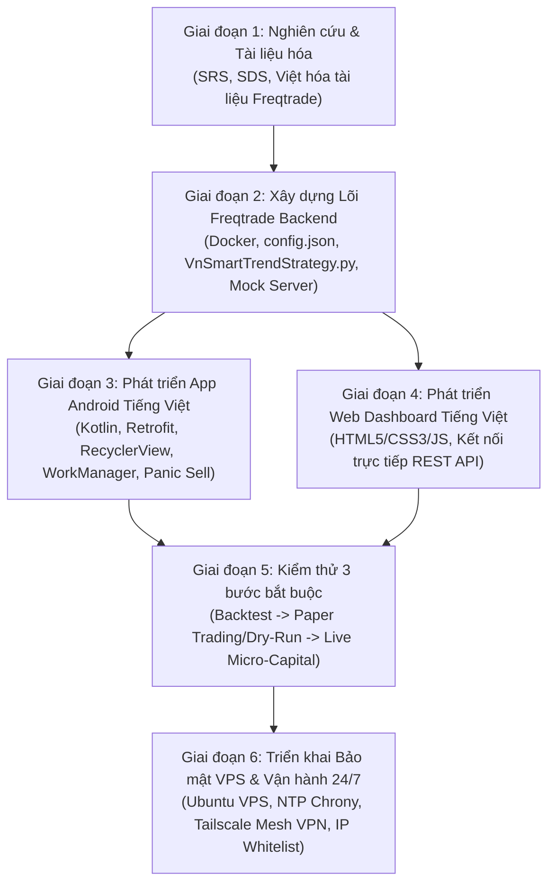

# KẾ HOẠCH TRIỂN KHAI DỰ ÁN (PROJECT MANAGEMENT PLAN)
**Tên dự án:** Hệ thống Giao dịch Tiền điện tử Tự động & Ứng dụng Điều khiển Từ xa Tiếng Việt (**FreqBot VN Remote**)  
**Phiên bản:** 1.0.0  
**Ngày lập:** 27/10/2026  

---

## 1. Mục Tiêu Của Kế Hoạch Dự Án

Tài liệu này xác định lộ trình triển khai, phân chia các giai đoạn công việc (Work Breakdown Structure - WBS), tiêu chí nghiệm thu kỹ thuật và **Quy trình kiểm thử 3 bước bắt buộc** trước khi đưa hệ thống vào vận hành với vốn thực tế.

---

## 2. Sơ Đồ Lộ Trình Triển Khai (Project Roadmap)

---

## 3. Phân Chia Giai Đoạn & Hạng Mục Công Việc Chi Tiết (WBS)

| Mã GĐ | Tên Giai Đoạn | Hạng Mục Công Việc Cụ Thể | Sản Phẩm Bàn Giao (Deliverables) | Trạng Thái |
| :--- | :--- | :--- | :--- | :--- |
| **GĐ 1** | **Phân tích, Thiết kế & Việt hóa Tài liệu** | 1.1. Viết tài liệu Giới thiệu & Kế hoạch dự án 1.2. Viết Đặc tả yêu cầu (SRS) & Thiết kế hệ thống (SDS) 1.3. Viết tài liệu Quản trị rủi ro & Hướng dẫn vận hành 1.4. Tải và Việt hóa bộ tài liệu lõi Freqtrade (7 chuyên đề) | - Bộ tài liệu `docs/01` đến `docs/06` - Bộ tài liệu `docs/freqtrade-vi/00` đến `06` | Hoàn thành |
| **GĐ 2** | **Xây dựng Phân hệ Backend Freqtrade** | 2.1. Thiết lập `docker-compose.yml` và cấu hình `config.json` (bật `api_server`, `protections`) 2.2. Lập trình chiến lược `VnSmartTrendStrategy.py` kèm thông báo đẩy Tiếng Việt 2.3. Xây dựng `mock_api_server.py` giả lập REST API Freqtrade để kiểm thử nhanh UI | - `freqtrade-bot/docker-compose.yml` - `freqtrade-bot/user_data/config.json` - `VnSmartTrendStrategy.py` - `mock_api_server.py` | Hoàn thành |
| **GĐ 3** | **Phát triển Ứng dụng Android Điều khiển Từ xa** | 3.1. Khởi tạo cấu trúc Gradle Kotlin (`com.freqbot.vnremote`) 3.2. Xây dựng Data Models (`TradeModels.kt`) & Retrofit API (`FreqtradeApi.kt`, `RetrofitClient.kt`) 3.3. Xây dựng giao diện điều khiển Tiếng Việt (`MainActivity.kt`, `OpenTradeAdapter.kt`, XML Layouts) 3.4. Lập trình dịch vụ ngầm `RiskMonitorWorker.kt` (`WorkManager`) đẩy cảnh báo Tiếng Việt | - Toàn bộ mã nguồn trong `android-app/` | Hoàn thành |
| **GĐ 4** | **Phát triển Giao diện Web Dashboard Tiếng Việt** | 4.1. Thiết kế giao diện bảng điều khiển Tiếng Việt trên trình duyệt (`index.html`, `styles.css`) 4.2. Lập trình module kết nối API Freqtrade (`app.js`) với chức năng Đăng nhập JWT, Bảng lệnh mở, Tạm dừng mua & Bán khẩn cấp | - Toàn bộ mã nguồn trong `web-dashboard/` | Hoàn thành |
| **GĐ 5** | **Quy trình Kiểm thử 3 bước bắt buộc** | 5.1. Kiểm thử giao diện Android & Web với Mock Server / Dry-Run 5.2. Bước 1: Backtesting chiến lược trên dữ liệu lịch sử 6–12 tháng 5.3. Bước 2: Paper Trading (`dry_run: true`) thời gian thực 1–2 tuần 5.4. Bước 3: Live Micro-Capital (vốn nhỏ 20–50 USDT) | - Báo cáo Backtest & Nhật ký Dry-Run | Sẵn sàng thực hiện |
| **GĐ 6** | **Triển khai Hạ tầng Bảo mật & Vận hành** | 6.1. Thiết lập Ubuntu VPS (Tokyo/Singapore), đồng bộ giờ NTP (`Chrony`) 6.2. Thiết lập mạng riêng ảo Tailscale (`100.x.y.z`) giữa VPS và điện thoại Android 6.3. Cấu hình API Key sàn (Không quyền Rút tiền + IP Whitelist) | - Hệ thống vận hành 24/7 an toàn | Sẵn sàng thực hiện |

---

## 4. Quy Trình Kiểm Thử Giao Dịch 3 Bước Bắt Buộc

Để đảm bảo an toàn vốn tuyệt đối, dự án quy định **không bao giờ chạy tiền thật ngay lập tức** mà phải vượt qua 3 bước kiểm thử tuần tự:

### Bước 1: Kiểm thử Lịch sử (Backtesting)
- **Mục tiêu:** Đánh giá hiệu quả toán học của chiến lược [`VnSmartTrendStrategy.py`](file:///e:/Project/trade_bot/freqtrade-bot/user_data/strategies/VnSmartTrendStrategy.py) trên dữ liệu nến lịch sử tối thiểu 6–12 tháng (bao gồm cả giai đoạn thị trường Tăng - Bull, Giảm - Bear và Đi ngang - Sideways).
- **Yêu cầu kỹ thuật:**
  - Phải tính đủ phí giao dịch của sàn (thường là `0.1%` mỗi chiều trên Spot, tức `--fee 0.001`).
  - Kiểm tra không mắc lỗi "nhìn trước tương lai" (Look-ahead bias).
  - Tiêu chí đạt: Lợi nhuận kỳ vọng dương, `Max Drawdown` nằm trong ngưỡng chịu đựng (dưới 10–15%).

### Bước 2: Giao dịch Giả lập Thời gian thực (Paper Trading / Dry-Run)
- **Mục tiêu:** Kiểm tra sự ổn định của toàn bộ hệ thống (Freqtrade + App Android + Web Dashboard) với luồng giá WebSocket thời gian thực nhưng khớp lệnh bằng vốn giả lập (`"dry_run": true`, `"dry_run_wallet": 1000`).
- **Thời gian tối thiểu:** 1 – 2 tuần liên tục.
- **Hạng mục kiểm tra:**
  - App Android kết nối ổn định qua JWT, tự động làm mới dữ liệu mỗi 5 giây không bị treo UI.
  - Thử nghiệm bấm nút **"Tạm dừng Mua mới"** và nút đỏ **"Bán khẩn cấp (Panic Sell)"** trên điện thoại Android xem bot phản hồi tức thì hay không.
  - Kiểm tra `RiskMonitorWorker` có đẩy thông báo Tiếng Việt lên màn hình khóa khi có lệnh lỗ sâu hoặc mất kết nối máy chủ hay không.

### Bước 3: Giao dịch Thực tế Vốn Nhỏ (Live Micro-Capital)
- **Mục tiêu:** Kiểm nghiệm tốc độ khớp lệnh thực tế trên sàn, độ trượt giá (Slippage), quy tắc làm tròn khối lượng (`stepSize`, `minNotional`) và lệnh cắt lỗ cứng trên sàn (`stoploss_on_exchange`).
- **Quy mô vốn:** Chỉ sử dụng từ **20 USDT đến 50 USDT** (mỗi lệnh 10–15 USDT).
- **Tiêu chí nâng vốn:** Chỉ khi hệ thống vận hành trơn tru không phát sinh lỗi kỹ thuật trong ít nhất 2–4 tuần ở Bước 3 mới được phép nâng dần quy mô vốn trong hạn mức rủi ro cho phép.

---

## 5. Quản Lý Rủi Ro Dự Án & Phương Án Dự Phòng

| Rủi ro | Mức độ | Biện pháp phòng ngừa & Xử lý trong dự án |
| :--- | :--- | :--- |
| **VPS mất mạng hoặc sập nguồn khi đang có lệnh mở** | Nghiêm trọng | Bật `stoploss_on_exchange: true` trong cấu hình để lệnh cắt lỗ nằm trực tiếp trên máy chủ sàn Binance/Bybit; dùng Docker `restart: unless-stopped` để tự khởi động lại. |
| **Lệch đồng hồ hệ thống VPS gây lỗi từ chối lệnh (`recvWindow`)** | Cao | Cài đặt dịch vụ đồng bộ thời gian `chrony` (NTP) trên Linux VPS để độ lệch luôn dưới 10ms. |
| **Lộ cổng điều khiển API 8080 ra Internet công cộng** | Nghiêm trọng | Không mở port 8080 trên Firewall công cộng; chỉ bind vào địa chỉ IP mạng riêng ảo **Tailscale (`100.x.y.z`)** kết hợp xác thực mật khẩu mạnh + JWT Token. |
| **Bấm nhầm nút Bán khẩn cấp trên điện thoại** | Trung bình | Thiết kế hộp thoại cảnh báo 2 bước (`AlertDialog`) bằng Tiếng Việt yêu cầu xác nhận rõ ràng trước khi gọi `/api/v1/forceexit`. |
