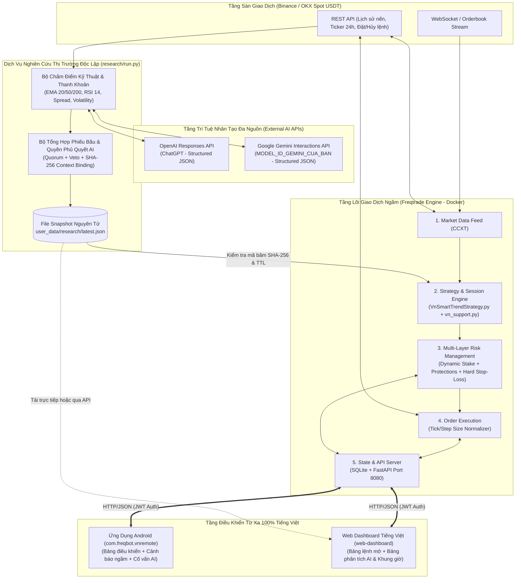
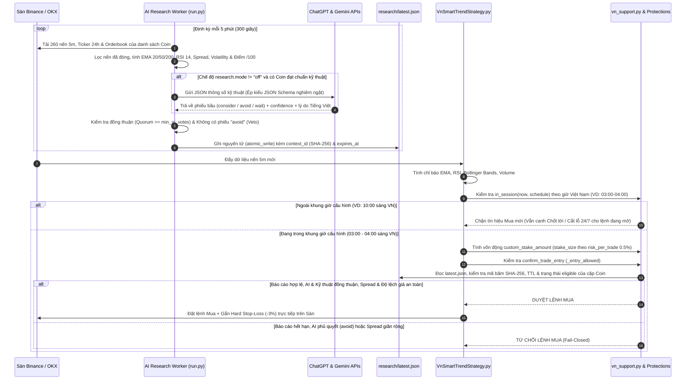

# ĐẶC TẢ THIẾT KẾ HỆ THỐNG (SOFTWARE DESIGN SPECIFICATION - SDS)
**Tên dự án:** Hệ thống Giao dịch Tiền điện tử Tự động, Phân tích AI Đa nguồn & Ứng dụng Điều khiển Từ xa Tiếng Việt (**FreqBot VN Remote**) 
**Phiên bản:** 2.0.0 
**Ngày cập nhật:** 27/10/2026 

---

## 1. Thiết Kế Kiến Trúc Tổng Thể (System Architecture)

Hệ thống được thiết kế theo mô hình **Client-Server phân tán kết hợp Kiến trúc hướng sự kiện (Event-Driven Architecture)** và **Cô lập Đặc quyền cho Tầng Nghiên cứu AI (Privilege-Separated AI Research Worker)**:

---

## 2. Thiết Kế Luồng Xử Lý Tín Hiệu, Khung Giờ Cấu Hình & Hội Đồng Cố Vấn AI

---

## 3. Thiết Kế Chi Tiết Module Chính Sách & Toán Học Rủi Ro (`vn_support.py`)

File [`freqtrade-bot/user_data/strategies/vn_support.py`](file:///d:/Project/trade_bot/freqtrade-bot/user_data/strategies/vn_support.py) chứa toàn bộ các hàm thuần túy (pure functions), không phụ thuộc mạng, dễ dàng kiểm thử đơn vị 100%:

1. **`in_session(now, schedule)` — Bộ lọc Khung Giờ Giao Dịch theo Múi Giờ Việt Nam (`UTC+7`):**
   - Chuyển đổi mọi mốc thời gian có múi giờ (`aware(now)`) sang múi giờ `VN = timezone(timedelta(hours=7), "Asia/Ho_Chi_Minh")`.
   - Kiểm tra xem thời điểm đóng nến hiện tại có nằm trong bất kỳ khung giờ `[start, end)` nào của `schedule["windows"]` hay không (hỗ trợ cả khung giờ trong ngày như `03:00`–`04:00` lẫn khung giờ qua đêm như `23:00`–`04:00`).
2. **`stake_size(equity, proposed, maximum, minimum, used, stoploss, risk)` — Công thức Phân bổ Vốn Động:**
   $$\text{Stake} = \min\left(\text{proposed}, \text{maximum}, \text{Equity} \times f_{\text{pos}}, \frac{\text{Equity} \times r_{\text{trade}}}{|\text{stoploss}| + c_{\text{buf}}}, \max(0, \text{Equity} \times f_{\text{exp}} - \text{used})\right)$$
   Trong đó:
   - $r_{\text{trade}}$ (`risk_per_trade`, mặc định `0.005` = `0.5%` tổng vốn): Số tiền tối đa chấp nhận mất trên 1 lệnh nếu chạm Stop-Loss cộng đệm phí/trượt giá $c_{\text{buf}}$ (`cost_buffer = 0.004`).
   - $f_{\text{pos}}$ (`max_position_fraction = 0.2`): Không bao giờ dồn quá `20%` tổng tài sản vào một đồng coin duy nhất.
   - $f_{\text{exp}}$ (`max_exposure_fraction = 0.6`): Tổng giá trị tất cả các lệnh đang mở không vượt quá `60%` tổng tài sản (luôn giữ tối thiểu `40%` tiền mặt USDT dự phòng).
3. **`context_id(config)` & `report_allows(report, config, pair, now)` — Khóa Ngữ Cảnh SHA-256:**
   - Tạo mã băm `SHA-256` từ tên sàn (`binance` / `okx`), danh sách `pair_whitelist`, `pair_blacklist` và cấu hình `vn_policy.research`.
   - Đảm bảo báo cáo AI phải đúng phiên bản (`schema_version == 1`), khớp `context_id`, còn trong thời hạn `created <= now < expires` và đồng coin có `eligible == True`.

---

## 4. Thiết Kế Chi Tiết Phân Hệ Nghiên Cứu Thị Trường & Đề Xuất Coin AI (`research/`)

### 4.1. Bộ Phân Tích Kỹ Thuật & Chấm Điểm (`research/run.py`)
Hàm `analyze(pair, candles, ticker, book, now, settings)` thực hiện:
- Loại bỏ cây nến đang chạy chưa đóng (`number(row[0]) + 300_000 <= now_ms`) để chống nhiễu tín hiệu giả (Repainting).
- Tính toán:
  - Đường trung bình động `EMA(20)`, `EMA(50)`, `EMA(200)`.
  - RSI14 được tính trong cả chiến lược và worker (Wilder; giá phẳng quy ước 50 trong worker).
  - Tỷ lệ khối lượng `volume_ratio` (so với trung bình 20 nến trước đó).
  - Độ giãn sổ lệnh `spread = (ask - bid) / mid`.
  - Biến động 1 giờ `hour_change` (12 nến 5m) và độ lệch chuẩn lợi suất logarit `volatility_5m` (24 nến 5m).
- Điểm tổng hợp `score` (0–100) để sắp xếp; regime phân loại bằng luật EMA/RSI/volume/spread, chưa phải mô hình dự báo được kiểm chứng.

### 4.2. Bộ Giao Tiếp Đa Nguồn AI (`research/providers.py`)
Hàm `advise(provider, model, candidates)` hỗ trợ:
- **`openai` (ChatGPT):** Gọi `https://api.openai.com/v1/responses` với cấu hình `text.format.type = "json_schema"` (`strict: True`).
- **`gemini` (Google Gemini):** Gọi `/v1beta/interactions`, header `Api-Revision: 2026-05-20`, `response_format` với schema JSON và `generation_config.max_output_tokens = 4000`; chỉ đọc `steps`/`output_text` khi status completed. Parser tương thích candidates, không tự chuyển endpoint.
- **Chống Prompt Injection & Kiểm tra Biên:** Dữ liệu đầu vào chỉ là số liệu định lượng; kết quả trả về từ AI được kiểm duyệt qua `validate_votes(data, universe)` để đảm bảo AI không thể bịa thêm cặp coin ngoài danh sách hoặc trả về giá trị ngoài miền hợp lệ.
# Thiết kế bổ sung ngày 27/10/2026

Chi tiết: [tài liệu 07](07-LICH-GIAO-DICH-AI-VA-PHAN-TICH.md). Luồng: CCXT public → research worker → lọc kỹ thuật → adapter AI → snapshot/history → chiến lược → kiểm tra lịch/vốn/nến/orderbook → Freqtrade thực thi.

`vn_support.py` chứa các hàm thuần cho lịch UTC+7, sizing, spread, context và TTL. Worker không có quyền đặt lệnh hoặc private key sàn. `custom_stake_amount` tính vốn; `confirm_trade_entry` kiểm tra lại; lịch/AI không áp dụng lên `confirm_trade_exit`. Historical advisory/off không đọc snapshot/orderbook live, required bị từ chối. Web nhập JSON cục bộ hoặc đồng bộ từ mock, không thêm API vào Freqtrade thật; Android có thẻ tóm tắt nghiên cứu qua mock; Freqtrade thật chưa có endpoint nghiên cứu. Ghi snapshot bằng temporary file + replace. SHA256 nhận diện cấu hình, không xác thực người ghi tệp.
