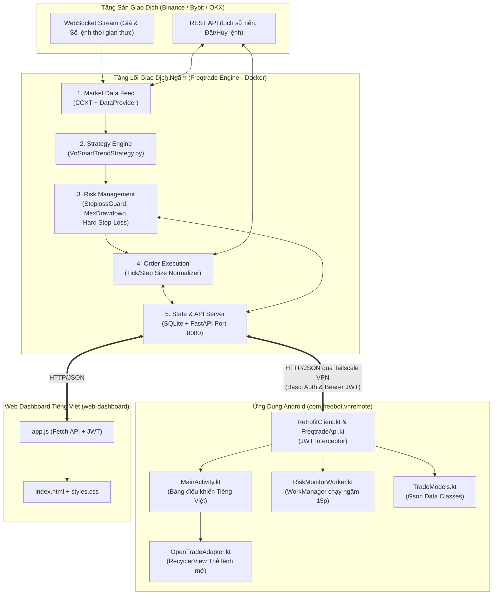
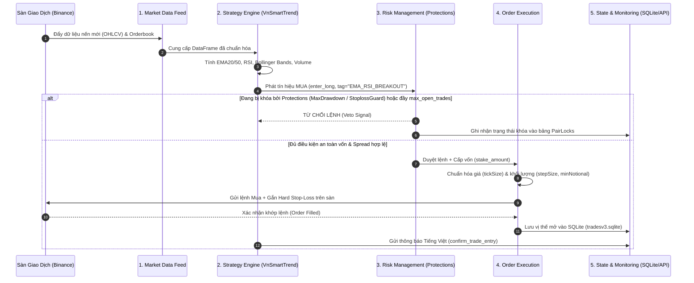
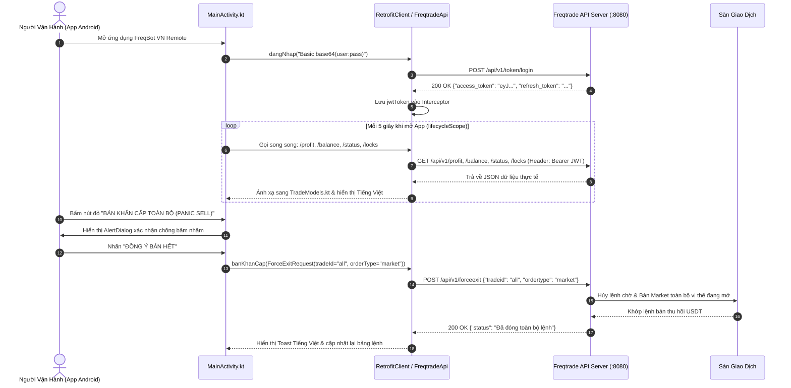
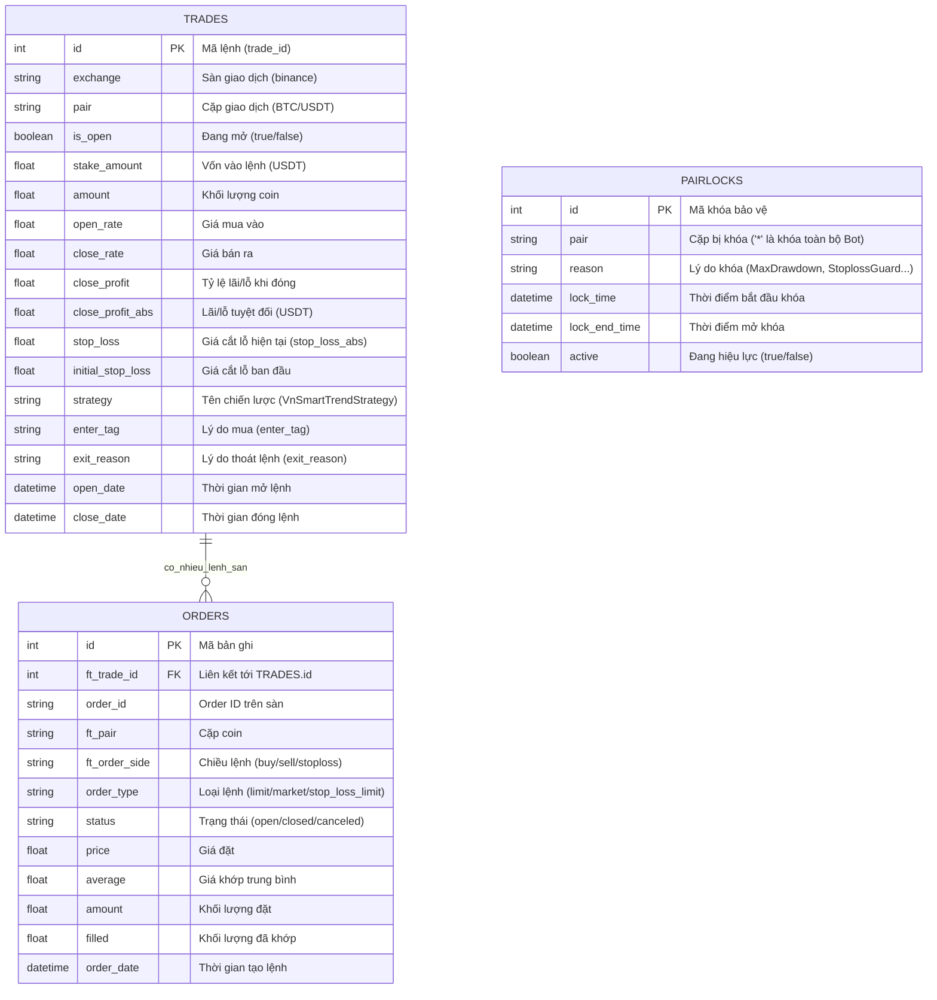
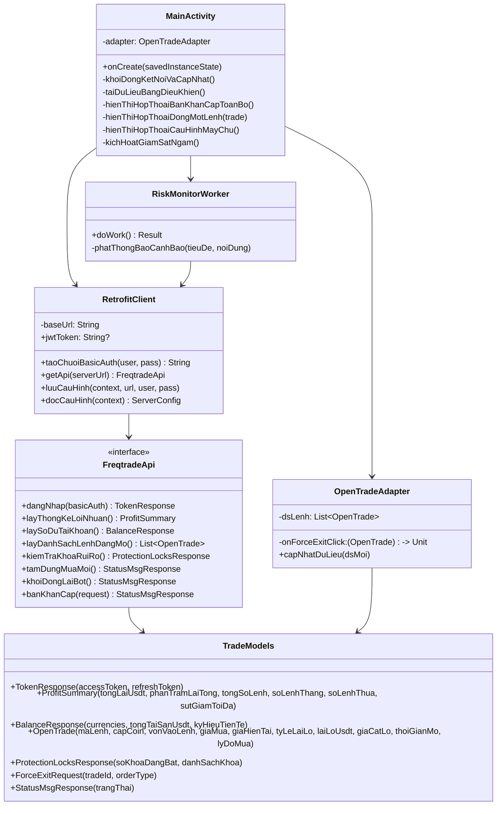

# ĐẶC TẢ THIẾT KẾ HỆ THỐNG (SOFTWARE DESIGN SPECIFICATION - SDS)
**Tên dự án:** Hệ thống Giao dịch Tiền điện tử Tự động & Ứng dụng Điều khiển Từ xa Tiếng Việt (**FreqBot VN Remote**)  
**Phiên bản:** 1.0.0  
**Ngày lập:** 27/10/2026  

---

## 1. Thiết Kế Kiến Trúc Tổng Thể (System Architecture)

Hệ thống được thiết kế theo mô hình **Client-Server phân tán kết hợp Kiến trúc hướng sự kiện (Event-Driven Architecture)**:
- **Server-side (Headless Trading Engine):** Lõi **Freqtrade** đóng gói trong Docker Container, tích hợp chiến lược Python [`VnSmartTrendStrategy.py`](file:///e:/Project/trade_bot/freqtrade-bot/user_data/strategies/VnSmartTrendStrategy.py), cơ sở dữ liệu `SQLite` và máy chủ `FastAPI/REST API` nội bộ cổng `8080`.
- **Client-side (Vietnamese Remote Controllers):**
  1. **Ứng dụng Android Native (`FreqBot VN Remote` - Kotlin):** Sử dụng kiến trúc phân tầng rõ ràng (`ui`, `data/api`, `data/model`, `worker`), giao tiếp bất đồng bộ qua `Retrofit2 + OkHttp3 + Kotlin Coroutines`, giám sát ngầm bằng `WorkManager`.
  2. **Ứng dụng Web Dashboard Tiếng Việt (`web-dashboard`):** Giao diện SPA gọn nhẹ viết bằng HTML5/CSS3/Vanilla JS gọi trực tiếp vào REST API của Freqtrade.

---

## 2. Thiết Kế Luồng Tương Tác & Xử Lý Sự Kiện (Sequence Diagrams)

### 2.1. Luồng xử lý tín hiệu giao dịch và kiểm duyệt rủi ro qua 5 phân hệ

### 2.2. Luồng Đăng nhập JWT, Đồng bộ thời gian thực & Bán khẩn cấp (Panic Sell) từ App Android

---

## 3. Thiết Kế Cơ Sở Dữ Liệu (Database Design - ERD)

Lõi Freqtrade sử dụng cơ sở dữ liệu quan hệ **SQLite (`tradesv3.sqlite`)** thông qua SQLAlchemy ORM với 3 bảng thực thể cốt lõi phục vụ giao dịch và quản trị rủi ro:

---

## 4. Thiết Kế Chi Tiết Phân Hệ Chiến Lược Backend (`VnSmartTrendStrategy.py`)

File chiến lược [`VnSmartTrendStrategy.py`](file:///e:/Project/trade_bot/freqtrade-bot/user_data/strategies/VnSmartTrendStrategy.py) kế thừa lớp `IStrategy` của Freqtrade và được thiết kế gồm 5 khối:
1. **Tham số quản trị rủi ro & ROI động (`minimal_roi`, `stoploss`, `trailing_stop`):**
   - `stoploss = -0.03` (Cắt lỗ cứng ở mức `-3%` cho mỗi vị thế).
   - `trailing_stop = True`, `trailing_stop_positive = 0.01`, `trailing_stop_positive_offset = 0.025` (Khi lệnh lãi đạt `+2.5%`, tự động dịch chuyển mốc cắt lỗ trượt theo sau `1%` để khóa lợi nhuận).
2. **Cấu hình Bộ Giáp Bảo Vệ (`protections` property):**
   - `CooldownPeriod`: Khóa cặp coin 30 phút sau khi vừa đóng lệnh.
   - `MaxDrawdown`: Nếu lỗ thực tế vượt `5%` trong 24 giờ gần nhất, khóa toàn bộ bot trong `12 giờ`.
   - `StoplossGuard`: Nếu dính `3 lệnh` cắt lỗ trong vòng `6 giờ`, khóa toàn bộ bot trong `6 giờ`.
   - `LowProfitPairs`: Nếu 1 cặp coin có từ 2 lệnh đóng với tổng lỗ `<= -3%` trong 12 giờ, tạm khóa riêng cặp coin đó 6 giờ.
3. **Tính toán chỉ báo (`populate_indicators`):**
   - Đường trung bình động `EMA 20`, `EMA 50`, `EMA 200`.
   - Chỉ số sức mạnh tương đối `RSI (14)`.
   - Dải `Bollinger Bands (20, 2.0)`.
   - Khối lượng giao dịch trung bình `Volume SMA (20)`.
4. **Quy tắc vào lệnh (`populate_entry_trend`) & Thoát lệnh (`populate_exit_trend`):**
   - **Tín hiệu Mua 1 (`XU_HUONG_TANG_EMA_RSI`):** Xu hướng chính tăng (`close > EMA200`, `EMA20 > EMA50`), `RSI` nằm trong vùng tích lũy khỏe (`45 < RSI < 68`) và khối lượng đột biến (`volume > 1.2 * volume_mean_20`).
   - **Tín hiệu Mua 2 (`BAT_DAY_BOLLINGER_RSI`):** Giá chạm dải dưới Bollinger (`close < bb_lowerband * 1.005`) trong khi `RSI < 32` và bắt đầu rút chân tăng trở lại (`close > open`).
   - **Tín hiệu Bán (`CHOT_LOI_QUA_MUA_RSI` / `GA_Y_XU_HUONG_EMA`):** Khi `RSI > 78` chạm dải trên Bollinger hoặc `EMA20` cắt xuống dưới `EMA50`.
5. **Hàm Callback Việt hóa thông báo đẩy (`confirm_trade_entry`, `confirm_trade_exit`):**
   - Phát tin nhắn định dạng Tiếng Việt qua `self.dp.send_msg(...)` mỗi khi vào lệnh hoặc đóng lệnh.

---

## 5. Thiết Kế Chi Tiết Ứng Dụng Android (`com.freqbot.vnremote`)

### 5.1. Sơ đồ Lớp (Class Diagram) của Ứng dụng Android

### 5.2. Thiết kế Cơ chế Chạy ngầm & Cảnh báo (`RiskMonitorWorker.kt`)
- Sử dụng `PeriodicWorkRequestBuilder<RiskMonitorWorker>(15, TimeUnit.MINUTES)` với điều kiện `NetworkType.CONNECTED`.
- Trong `doWork()`:
  1. Đọc thông tin cấu hình máy chủ (`baseUrl`, `username`, `password`) từ `SharedPreferences`.
  2. Gọi API đăng nhập lấy `jwtToken` mới nhất, sau đó truy vấn `/api/v1/status` và `/api/v1/locks`.
  3. Kiểm tra nếu có bất kỳ lệnh nào có `tyLeLaiLo <= -0.03` (lỗ từ `3%` trở lên) hoặc `soKhoaDangBat > 0` (đang kích hoạt khóa rủi ro), lập tức tạo kênh thông báo `NotificationChannel` mức ưu tiên cao (`IMPORTANCE_HIGH`) và phát cảnh báo Tiếng Việt lên điện thoại.
  4. Nếu không thể kết nối tới máy chủ VPS, phát thông báo cảnh báo kiểm tra kết nối mạng/VPS và trả về `Result.retry()`.
