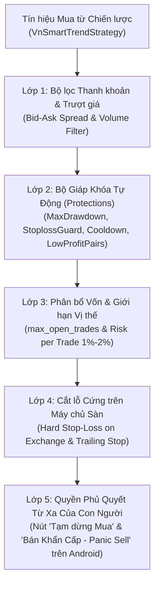

# TÀI LIỆU QUẢN TRỊ RỦI RO & BẢO MẬT VẬN HÀNH (RISK MANAGEMENT & SECURITY SPECIFICATION)
**Tên dự án:** Hệ thống Giao dịch Tiền điện tử Tự động & Ứng dụng Điều khiển Từ xa Tiếng Việt (**FreqBot VN Remote**)  
**Phiên bản:** 1.0.0  
**Ngày lập:** 27/10/2026  

---

## 1. Triết Lý Bảo Toàn Vốn Trong Giao Dịch Tự Động

Trong giao dịch thuật toán (Algorithmic Trading), **sống sót và bảo toàn vốn quan trọng hơn tối đa hóa lợi nhuận ngắn hạn**. Vì thị trường Crypto biến động 24/7 không có biên độ trần/sàn như chứng khoán truyền thống, hệ thống **FreqBot VN Remote** thiết lập **5 Lớp Giáp Bảo Vệ Vốn** độc lập từ cấp độ từng lệnh đơn lẻ cho tới cấp độ toàn tài khoản.

---

## 2. Năm Lớp Giáp Quản Trị Rủi Ro (5-Layer Capital Armor)



### 2.1. Lớp 1: Bộ lọc Biến động bất thường & Thanh khoản (`Volatility & Spread Filter`)
- Kiểm tra độ sâu sổ lệnh (`check_depth_of_market`) và chênh lệch giá Mua/Bán (`Bid-Ask Spread`).
- Nếu chênh lệch giá giãn rộng bất thường (ví dụ khi có tin tức vĩ mô lớn) hoặc độ trượt giá vượt ngưỡng cho phép, bot tự động hủy bỏ việc vào lệnh.

### 2.2. Lớp 2: Bộ Giáp Ngắt Mạch Tự Động (`Protections` / Circuit Breakers)
Được lập trình trực tiếp trong [`VnSmartTrendStrategy.py`](file:///e:/Project/trade_bot/freqtrade-bot/user_data/strategies/VnSmartTrendStrategy.py) và hiển thị trạng thái bằng Tiếng Việt trên ứng dụng Android:
1. **`MaxDrawdown` (Hạn mức sụt giảm tối đa ngày):**
   - Kiểm tra lịch sử 24 giờ gần nhất (`lookback_period_candles = 288` nến 5 phút).
   - Nếu tổng lỗ chạm ngưỡng `5%` (`max_allowed_drawdown = 0.05`), tự động **khóa toàn bộ bot trong 12 giờ** (`stop_duration_candles = 144`).
2. **`StoplossGuard` (Chống chuỗi cắt lỗ liên tiếp khi sập hầm):**
   - Kiểm tra trong vòng 6 giờ (`lookback_period_candles = 72`).
   - Nếu có `3 lệnh` bị dính Stop-Loss (`trade_limit = 3`), lập tức **khóa toàn bộ giao dịch mua mới trong 6 giờ** để tránh bắt dao rơi khi Bitcoin điều chỉnh mạnh.
3. **`LowProfitPairs` (Cách ly cặp coin hiệu suất kém):**
   - Nếu một cặp coin cụ thể có từ 2 lệnh đóng với tổng mức lỗ nặng hơn `-3%` trong 12 giờ, tự động khóa riêng cặp coin đó trong 6 giờ.
4. **`CooldownPeriod` (Thời gian nghỉ sau khi đóng lệnh):**
   - Khóa cặp coin vừa đóng lệnh trong `30 phút` (6 nến 5m) để tránh vào lại lệnh liên tục tại cùng một vùng giá nhiễu.

### 2.3. Lớp 3: Giới hạn Rủi ro trên mỗi lệnh (`Position Sizing & Max Open Trades`)
- **Giới hạn số lệnh mở đồng thời (`max_open_trades`):** Tối đa `3` đến `5` lệnh mở cùng lúc để không bị dàn trải hoặc kẹt 100% vốn khi thị trường đảo chiều.
- **Công thức tính rủi ro mỗi lệnh (Risk per Trade):**
  $$\text{Rủi ro thực tế mỗi lệnh (\% Tổng vốn)} = \frac{\text{Vốn vào 1 lệnh (stake\_amount)}}{\text{Tổng vốn tài khoản}} \times |\text{Stop-Loss \%}|$$
  *Ví dụ:* Với tổng vốn `1.000 USDT`, chia tối đa 4 lệnh (`stake_amount = 250 USDT`), mức cắt lỗ cứng `stoploss = -3%` (`-0.03`), thì nếu lệnh đó chạm Stop-Loss, số tiền mất tối đa là $250 \times 3\% = 7.5\text{ USDT}$, tương đương **chỉ mất `0.75%` tổng vốn tài khoản** (nằm gọn dưới ngưỡng an toàn 1%–2%).

### 2.4. Lớp 4: Lệnh Cắt lỗ Cứng nằm trên Máy chủ Sàn (`Hard Stop-Loss on Exchange`)
- Trong `config.json`, cấu hình:
  ```json
  "order_types": {
      "entry": "limit",
      "exit": "limit",
      "emergency_exit": "market",
      "force_exit": "market",
      "stoploss": "market",
      "stoploss_on_exchange": true,
      "stoploss_on_exchange_interval": 60
  }
  ```
- **Ý nghĩa sống còn:** Ngay sau khi lệnh Mua khớp, Freqtrade lập tức đặt lệnh Stop-Loss trực tiếp lên sổ lệnh của sàn (Binance/Bybit). Kể cả khi máy chủ VPS bị mất điện, đứt cáp quang hay sập nguồn đúng lúc thị trường sập mạnh, máy chủ của sàn vẫn tự động khớp lệnh cắt lỗ bảo vệ tài khoản.

### 2.5. Lớp 5: Can thiệp Khẩn cấp Từ Xa (`Remote Kill-Switch` trên Android & Web)
- Người vận hành theo dõi qua ứng dụng Android **FreqBot VN Remote** có 2 quyền năng tối cao:
  - **Nút "Tạm dừng Mua mới" (`/api/v1/stopbuy`):** Dùng khi thấy tin tức thị trường tiêu cực, không cho bot mua thêm nhưng vẫn giữ các lệnh đang có để chờ chốt lời.
  - **Nút đỏ "Bán khẩn cấp toàn bộ - Panic Sell" (`/api/v1/forceexit`):** Bán toàn bộ danh mục đang giữ theo giá thị trường (`Market`) về `USDT` chỉ với 1 chạm xác nhận.

---

## 3. Tiêu Chuẩn Bảo Mật Hạ Tầng & Khóa API

### 3.1. Nguyên tắc Bảo mật Khóa API Sàn Giao Dịch (Exchange API Key Security)
1. **Quyền tối thiểu (Least Privilege):**
   - `[x]` Bật quyền Đọc dữ liệu (*Enable Reading*).
   - `[x]` Bật quyền Giao dịch Spot (*Enable Spot & Margin Trading*).
   - `[ ]` **TUYỆT ĐỐI KHÔNG** bật quyền Rút tiền (*Enable Withdrawals*).
2. **Giới hạn địa chỉ IP (IP Whitelisting):**
   - Trong trang quản lý API của Binance/Bybit, chọn *"Restrict access to trusted IPs only"* và điền duy nhất địa chỉ IPv4 tĩnh của máy chủ Linux VPS chạy bot.
3. **Lưu trữ khóa bí mật:**
   - Tuyệt đối không đưa `api_key`, `api_secret` và `jwt_secret_key` thật lên kho lưu trữ Git công khai. Phân quyền file `chmod 600 user_data/config.json` trên máy chủ Linux.

### 3.2. Mô hình Mạng Riêng Ảo Nội Bộ (Mesh VPN với Tailscale / ZeroTier)
Thay vì mở cổng `8080` của Freqtrade ra Internet công cộng (dễ bị botnet quét cổng và tấn công Brute-force):
1. Cài đặt **Tailscale** trên cả máy chủ Ubuntu VPS và điện thoại Android, đăng nhập cùng một tài khoản cá nhân.
2. Máy chủ VPS sẽ được cấp một địa chỉ IP nội bộ Tailscale cố định dạng `100.x.y.z` (ví dụ `100.88.10.25`).
3. Trong `config.json` của Freqtrade, cấu hình `"listen_ip_address": "100.88.10.25"` (hoặc chặn cổng 8080 trên cổng mạng public `ufw deny 8080/tcp` và chỉ cho phép trên giao diện `tailscale0`: `ufw allow in on tailscale0 to any port 8080 proto tcp`).
4. Trên ứng dụng Android **FreqBot VN Remote**, nhập địa chỉ máy chủ là `http://100.88.10.25:8080/`. Toàn bộ lưu lượng điều khiển được mã hóa WireGuard đầu cuối.
