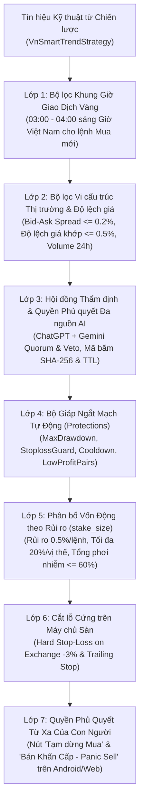

# TÀI LIỆU QUẢN TRỊ RỦI RO & BẢO MẬT VẬN HÀNH (RISK MANAGEMENT & SECURITY SPECIFICATION)
**Tên dự án:** Hệ thống Giao dịch Tiền điện tử Tự động, Phân tích AI Đa nguồn & Ứng dụng Điều khiển Từ xa Tiếng Việt (**FreqBot VN Remote**) 
**Phiên bản:** 2.0.0 
**Ngày cập nhật:** 27/10/2026 

---

## 1. Triết Lý Bảo Toàn Vốn Trong Giao Dịch Tự Động

Trong giao dịch thuật toán (Algorithmic Trading) trên **Binance** và **OKX**, **sống sót và bảo toàn vốn quan trọng hơn tối đa hóa lợi nhuận ngắn hạn**. Vì thị trường Crypto biến động 24/7 không có biên độ trần/sàn như chứng khoán truyền thống, hệ thống **FreqBot VN Remote v2.0** thiết lập **7 Lớp Giáp Bảo Vệ Vốn** độc lập từ cấp độ khung giờ, thẩm định AI cho tới cấp độ từng lệnh và toàn tài khoản.

---

## 2. Bảy Lớp Giáp Quản Trị Rủi Ro (7-Layer Capital Armor)

### 2.1. Lớp 1: Bộ lọc Khung Giờ Giao Dịch Vàng (`vn_policy.schedule`)
- Mặc định chỉ cho phép mở vị thế Mua mới trong khung giờ **03:00 – 04:00 sáng theo giờ Việt Nam (`UTC+7`)** (hoặc các khung giờ do nhà đầu tư cấu hình).
- **Bảo vệ Bất đối xứng:** Việc khóa khung giờ **chỉ áp dụng cho chiều Mua vào (`enter_long`)**. Mọi vị thế đang mở vẫn được bot canh **Chốt lời (`ROI`, `Trailing Stop`), Cắt lỗ (`Stop-Loss`) và xử lý Bán khẩn cấp 24/7**.

### 2.2. Lớp 2: Bộ lọc Thanh khoản, Chênh lệch giá (`Spread`) & Độ trượt giá (`Entry Deviation`)
- Kiểm tra trực tiếp sổ lệnh (`Orderbook`) ngay tại giây phút chuẩn bị đặt lệnh (`confirm_trade_entry`):
  - Từ chối mua nếu `spread_ratio(bid, ask) > max_spread` (mặc định `0.2%`).
  - Từ chối mua nếu giá khớp hiện tại lệch quá `max_entry_deviation` (mặc định `0.5%`) so với giá đóng cửa của cây nến tín hiệu (chống mua đuổi khi giá vừa phóng vọt).

### 2.3. Lớp 3: Thẩm định Đa nguồn AI & Cơ chế Fail-Closed (`vn_policy.research`)
- Tách biệt hoàn toàn tiến trình nghiên cứu (`research/run.py`) khỏi tiến trình đặt lệnh.
- Mọi dữ liệu phản hồi từ **ChatGPT** và **Google Gemini** đều được coi là dữ liệu tư vấn không đáng tin cậy cho đến khi vượt qua kiểm tra `JSON Schema`, mã băm ngữ cảnh `SHA-256` (`context_id`) và thời hạn sống (`ttl_seconds`).
- Nếu bất kỳ mô hình AI nào đưa ra khuyến nghị `"avoid"` (phát hiện rủi ro cấu trúc), hệ thống kích hoạt quyền phủ quyết (`Veto`) không mở lệnh ở chế độ `required`.

### 2.4. Lớp 4: Bộ Giáp Ngắt Mạch Tự Động (`Protections` / Circuit Breakers)
1. **`MaxDrawdown`:** Kiểm tra lịch sử lệnh đã đóng trong 24 giờ gần nhất (`288` nến 5m). Nếu mức sụt giảm vượt `5%`, khóa toàn bộ bot trong `12 giờ`. *(Lưu ý: `MaxDrawdown` của Freqtrade tính trên các lệnh đã đóng, do đó hệ thống kết hợp thêm Lớp 5 và Lớp 6 để bảo vệ các lệnh đang mở).*
2. **`StoplossGuard`:** Nếu có `3 lệnh` bị dính Stop-Loss trong vòng `6 giờ`, lập tức khóa toàn bộ giao dịch mua mới trong `6 giờ`.
3. **`LowProfitPairs`:** Nếu một cặp coin có từ 2 lệnh đóng với tổng mức lỗ `<= -3%` trong 12 giờ, tự động khóa riêng cặp coin đó trong 6 giờ.
4. **`CooldownPeriod`:** Khóa cặp coin vừa đóng lệnh trong `30 phút` (6 nến 5m).

### 2.5. Lớp 5: Phân bổ Vốn Động theo Rủi ro (`vn_policy.risk` & `stake_size`)
- Với cấu hình mặc định `risk_per_trade = 0.005` (`0.5%`), `stoploss = -0.03` (`3%`), `cost_buffer = 0.004` (`0.4%`), `max_position_fraction = 0.20` (`20%`) và `max_exposure_fraction = 0.60` (`60%`):
  - Ngân sách lỗ tính toán mặc định là **0,5% vốn stake**; gap giá, trượt giá hoặc stop-limit không khớp có thể làm lỗ lớn hơn.
  - Giới hạn stake các lệnh mở tối đa **60% vốn stake**; không phải cam kết tỷ lệ tiền mặt/NAV thời gian thực.

### 2.6. Lớp 6 & Lớp 7: Hard Stop-Loss trên Sàn (`stoploss_on_exchange`) & Remote Kill-Switch
- Lệnh cắt lỗ cứng `-3%` nằm trực tiếp trên máy chủ khớp lệnh của **Binance / OKX**.
- Nút **"Tạm dừng Mua mới"** và **"Bán khẩn cấp toàn bộ (Panic Sell)"** trên ứng dụng Android & Web Dashboard cho phép nhà đầu tư gửi yêu cầu đóng vị thế về USDT; giá trị thu hồi phụ thuộc khớp lệnh thực tế.

---

## 3. Tiêu Chuẩn Bảo Mật Hạ Tầng, Khóa API Sàn & Khóa AI

1. **Nguyên tắc Cô lập Khóa (Key Isolation):**
   - Khóa API sàn (`exchange.key`, `exchange.secret`, `exchange.password` cho OKX) chỉ cấp quyền **Read** + **Spot Trading** (Tuyệt đối **KHÔNG** bật quyền Rút tiền / Withdrawals) và chỉ nằm ở tiến trình Freqtrade.
   - Khóa AI (`OPENAI_API_KEY`, `GEMINI_API_KEY`) chỉ truyền vào biến môi trường của tiến trình `research` (trong file `.env` đã được đưa vào `.gitignore`), tuyệt đối không nhúng vào mã nguồn giao diện Web hay đẩy lên GitHub.
2. **Giới hạn CORS & Bind IP:**
   - Trong `docker-compose.yml`, cổng `8080` mặc định chỉ bind vào `127.0.0.1:8080:8080` (hoặc IP mạng riêng ảo **Tailscale `100.x.y.z`** trên VPS).
# Hiệu chỉnh quản trị rủi ro ngày 27/10/2026

Áp dụng [tài liệu 07](07-LICH-GIAO-DICH-AI-VA-PHAN-TICH.md). Callback giới hạn stake theo ngân sách lỗ 0,5%, buffer 0,4%, tối đa 20% vốn/vị thế và 60% tổng exposure mặc định. Đây là giới hạn tính toán; gap giá, trượt giá và stop-limit không khớp có thể gây lỗ lớn hơn. MaxDrawdown không phải equity kill-switch theo ngày VN; StoplossGuard không đòi hỏi stoploss liên tiếp.

Binance Spot dùng stop-limit trên sàn, OKX overlay dùng stop-market; Bybit Spot hiện không hỗ trợ stoploss trên sàn qua Freqtrade. Cần xác minh khả năng sàn khi vận hành. Docker mặc định bind localhost, force-entry tắt, CORS giới hạn. Khóa AI chỉ ở biến môi trường research; không gửi khóa sàn/số dư/vị thế sang AI. Required không đủ đồng thuận hoặc snapshot lỗi/quá hạn thì chặn mua, không chặn thoát. Mật khẩu/JWT mẫu phải thay trước khi cho truy cập từ xa. Thư mục snapshot chỉ người vận hành/worker được phép ghi; SHA256 context không phải chữ ký xác thực.
